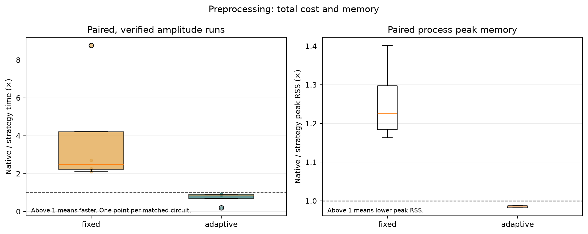
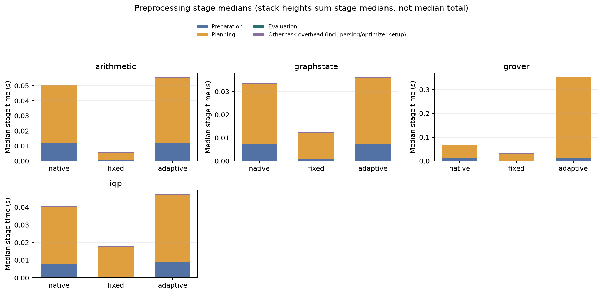
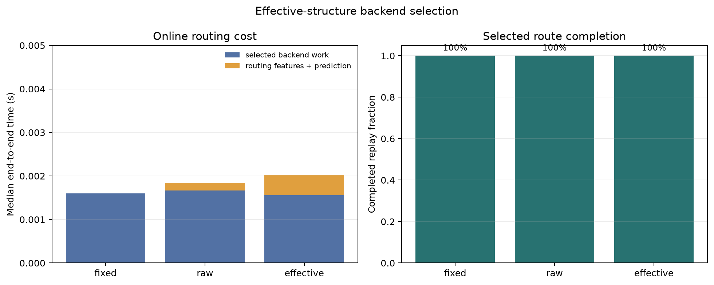
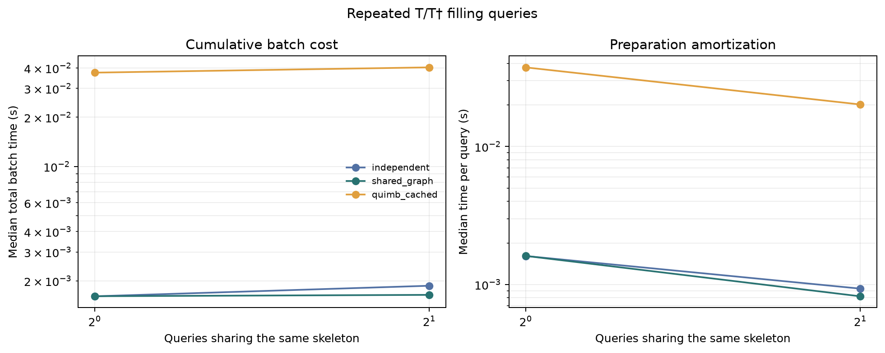
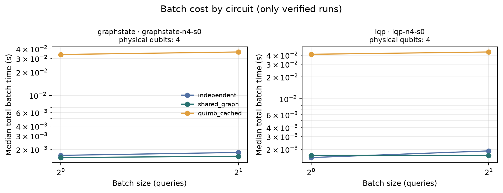

# Results: smoke

This report is generated from the JSONL run records. It does not treat a lower variable count or L value as an application speedup.

## Run scope

- Workload: 4 tasks across 4 circuit families.
- Recorded environment: Python 3.12.14, arm64, 10 logical CPUs; experiment workers use one numerical thread.
- Timing includes task JSON parsing, feature extraction or preprocessing, path planning, and evaluation inside each worker. Shared dependency import and process startup are recorded separately.
- Every per-run total is reconciled as the sum of its top-level recorded stages plus other_s = total_s minus the sum of timings_s. The residual contains work outside the detailed timers, including task parsing and dispatch. Nested selector feature and inference timers are included in its residual.
- Across 48 recorded runs, other_s ranges from 3.0459e-05 to 0.000798874 seconds; 0 residuals are below -1e-09 seconds.
- The preprocessing stage chart includes Other task overhead (incl. parsing/optimizer setup). The separate stage medians need not sum to the median end-to-end time.
- Process peak RSS is taken from OS high-water marks and sampled RSS; the run metadata documents the measurement scope and polling interval.
- The backend dataset reuses matching native Quimb rows from `preprocess.jsonl` when the source field marks them; record counts therefore are not counts of independent executions. Online selector replays are timed separately.
- The amplitude reference and per-run numerical verification are recorded separately. Failed, timed-out, unsupported, and unverified rows remain in the raw files.

## Measured records

There are 48 experiment records; 36 successful records across preprocessing, backend and selector runs carry a passing reference check.

| Experiment | Family / method | Runs | Success | Verified | Median time (s) | Median peak RSS (GiB) |
|---|---|---:|---:|---:|---:|---:|
| preprocess | arithmetic / adaptive | 1 | 1 | 1 | 0.0554985 | 0.061 |
| preprocess | arithmetic / fixed | 1 | 1 | 1 | 0.00576325 | 0.043 |
| preprocess | arithmetic / native | 1 | 1 | 1 | 0.05053 | 0.060 |
| preprocess | graphstate / adaptive | 1 | 1 | 1 | 0.0361438 | 0.059 |
| preprocess | graphstate / fixed | 1 | 1 | 1 | 0.0124601 | 0.046 |
| preprocess | graphstate / native | 1 | 1 | 1 | 0.0335858 | 0.058 |
| preprocess | grover / adaptive | 1 | 1 | 1 | 0.351207 | 0.065 |
| preprocess | grover / fixed | 1 | 1 | 1 | 0.0322051 | 0.054 |
| preprocess | grover / native | 1 | 1 | 1 | 0.0676973 | 0.063 |
| preprocess | iqp / adaptive | 1 | 1 | 1 | 0.0473583 | 0.060 |
| preprocess | iqp / fixed | 1 | 1 | 1 | 0.0178471 | 0.050 |
| preprocess | iqp / native | 1 | 1 | 1 | 0.0404289 | 0.060 |
| backends | arithmetic / mitm | 1 | 1 | 1 | 0.234681 | 0.230 |
| backends | arithmetic / quimb | 1 | 1 | 1 | 0.05053 | 0.060 |
| backends | arithmetic / statevector | 1 | 1 | 1 | 0.00194171 | 0.022 |
| backends | graphstate / mitm | 1 | 1 | 1 | 0.00164917 | 0.020 |
| backends | graphstate / quimb | 1 | 1 | 1 | 0.0335858 | 0.058 |
| backends | graphstate / statevector | 1 | 1 | 1 | 0.00108333 | 0.021 |
| backends | grover / mitm | 1 | 1 | 1 | 0.345477 | 0.231 |
| backends | grover / quimb | 1 | 1 | 1 | 0.0676973 | 0.063 |
| backends | grover / statevector | 1 | 1 | 1 | 0.00204708 | 0.022 |
| backends | iqp / mitm | 1 | 1 | 1 | 0.00173358 | 0.020 |
| backends | iqp / quimb | 1 | 1 | 1 | 0.0404289 | 0.060 |
| backends | iqp / statevector | 1 | 1 | 1 | 0.00130692 | 0.022 |
| selector | arithmetic / effective | 1 | 1 | 1 | 0.00223363 | 0.024 |
| selector | arithmetic / fixed | 1 | 1 | 1 | 0.00196004 | 0.022 |
| selector | arithmetic / raw | 1 | 1 | 1 | 0.00199462 | 0.023 |
| selector | graphstate / effective | 1 | 1 | 1 | 0.00181192 | 0.021 |
| selector | graphstate / fixed | 1 | 1 | 1 | 0.00108875 | 0.022 |
| selector | graphstate / raw | 1 | 1 | 1 | 0.00168171 | 0.021 |
| selector | grover / effective | 1 | 1 | 1 | 0.351639 | 0.231 |
| selector | grover / fixed | 1 | 1 | 1 | 0.00194496 | 0.022 |
| selector | grover / raw | 1 | 1 | 1 | 0.00202679 | 0.023 |
| selector | iqp / effective | 1 | 1 | 1 | 0.00138933 | 0.023 |
| selector | iqp / fixed | 1 | 1 | 1 | 0.00125354 | 0.022 |
| selector | iqp / raw | 1 | 1 | 1 | 0.00123083 | 0.023 |
| batch | graphstate / independent / 1 | 1 | 1 | 1 | 0.00167842 | 0.020 |
| batch | graphstate / independent / 2 | 1 | 1 | 1 | 0.00183025 | 0.020 |
| batch | graphstate / quimb_cached / 1 | 1 | 1 | 1 | 0.0337865 | 0.057 |
| batch | graphstate / quimb_cached / 2 | 1 | 1 | 1 | 0.03641 | 0.058 |
| batch | graphstate / shared_graph / 1 | 1 | 1 | 1 | 0.00157254 | 0.020 |
| batch | graphstate / shared_graph / 2 | 1 | 1 | 1 | 0.00163429 | 0.020 |
| batch | iqp / independent / 1 | 1 | 1 | 1 | 0.00153954 | 0.020 |
| batch | iqp / independent / 2 | 1 | 1 | 1 | 0.00190258 | 0.020 |
| batch | iqp / quimb_cached / 1 | 1 | 1 | 1 | 0.0411639 | 0.059 |
| batch | iqp / quimb_cached / 2 | 1 | 1 | 1 | 0.0443003 | 0.059 |
| batch | iqp / shared_graph / 1 | 1 | 1 | 1 | 0.00164954 | 0.020 |
| batch | iqp / shared_graph / 2 | 1 | 1 | 1 | 0.00164921 | 0.020 |

## Figures

| Figure | PNG | SVG |
|---|---|---|
| Preprocessing |  | [SVG](preprocess.svg) |
| Preprocessing stage costs |  | [SVG](preprocess_stages.svg) |
| Backend selection |  | [SVG](selector.svg) |
| Batch overview |  | [SVG](batch.svg) |
| Batch cost by circuit |  | [SVG](batch_by_task.svg) |

## Paired results

A pair is included only when every repeat for both methods completed and passed reference verification.

- Preprocessing `fixed`: median native/strategy time = 2.480× over 4 tasks; candidate faster on 4 and slower on 0.
- Preprocessing `adaptive`: median native/strategy time = 0.882× over 4 tasks; candidate faster on 0 and slower on 4.
- Selector `raw`: median fixed/raw end-to-end time = 0.971× over 4 tasks.
- Selector `effective`: median fixed/effective end-to-end time = 0.739× over 4 tasks.
- Selector `effective_vs_raw`: median raw/effective end-to-end time = 0.889× over 4 tasks.

## Structure and end-to-end cost

Among 4 tasks with rank-step metrics, rank decreased on 0; L increased on 0 of those. Estimated combo increased on 0 of 0 rank-decrease tasks with comparable candidate estimates. Across all comparable tasks, estimated combo increased on 0 of 4; this includes tasks where rank did not decrease.
The examples below compare paired medians for the complete adaptive and native workflows. Adaptive cost includes candidate generation, planning, evaluation, and task overhead; the smaller rank/L is a structural observation, not evidence that the rank change caused the runtime difference.

No rank-decrease task had fully verified matched native and adaptive repeats with adaptive slower in this run set.

## Offline backend-cost oracle regret

These are out-of-fold model predictions compared with the fastest measured backend per task. They are separate from measured online selector replays above. OOF prediction completion is not an independent amplitude verification.

| Policy | OOF tasks | Predictions completed | Median estimated total (s) | Median oracle regret (×) |
|---|---:|---:|---:|---:|
| effective | 4 | 4 | 0.00207665 | 1.261 |
| fixed | 4 | 4 | 0.00162431 | 1.000 |
| raw | 4 | 4 | 0.00182725 | 1.000 |

Selector routes include feature extraction and inference. The PAR2 view assigns each failed, timed-out, unsupported, or unverified replay twice the configured timeout; it complements the verified-pair comparison.

| Selector | Recorded replays | Correctly completed | Completion rate | Total PAR2 (s) |
|---|---:|---:|---:|---:|
| effective | 4 | 4 | 100% | 0.357074 |
| fixed | 4 | 4 | 100% | 0.00624729 |
| raw | 4 | 4 | 100% | 0.00693396 |

## Batch reuse by circuit

Each break-even entry is the first tested batch size for which the shared graph run is faster. It is reported only when every repeat for both compared methods passed verification.

| Task | Physical qubits | Unique queries by batch size | First shared win vs independent | First shared win vs Quimb cache |
|---|---:|---|---:|---:|
| graphstate-n4-s0 | 4 | 1: 1, 2: 2 | 1 | 1 |
| iqp-n4-s0 | 4 | 1: 1, 2: 2 | 2 | 1 |

## Reproduction files

The JSONL files preserve individual instances and failures. `summary.json` and the per-experiment CSV files are derived summaries. Re-run the report command after adding run records to rebuild this page and all charts.

This is a small, machine-specific CPU benchmark. A benefit is claimed only for the tested workload, where the measured end-to-end results and correctness checks support it.
